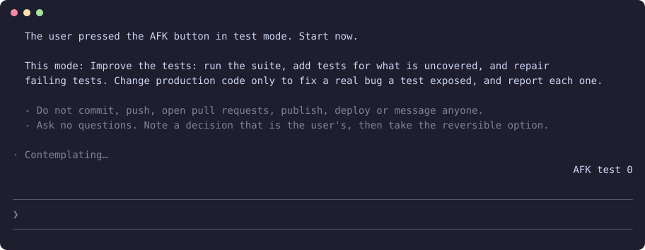

<h1 align="center">claude-afk</h1>

<p align="center"><b>Walk away and leave Claude working: develop, test, refactor or housekeeping, under rules you can read.</b></p>

<p align="center">
  
  
  
</p>

<p align="center"></p>

<p align="center"><sub>Only this mod enabled, in a real terminal session: `/afk test` sends the rules, and the button shows the mode and the turns taken.</sub></p>

Pick a mode and go for lunch. The session keeps taking the next step until the work runs out, a limit is reached, or you type again. It never commits, never pushes and never waits on a question.

## Install

In a terminal, inside Claude Code:

```
/plugin install afk --marketplace YlitaloJuha/claude-afk
```

Or from a shell:

```bash
claude plugin install afk --marketplace YlitaloJuha/claude-afk
```

In the desktop app, click + next to the prompt box, then Plugins, Add marketplace with `YlitaloJuha/claude-afk`, then Add plugin.

> [!NOTE]
> This repository is private for now. Installing needs read access and a GitHub credential on your machine, such as `gh auth login` then `gh auth setup-git`.

## What it does

- **Four modes:** `develop` builds what is already planned. `test` adds and repairs tests. `refactor` changes code without changing behaviour. `housekeeping` tidies docs and dead code.
- **Stops by itself:** When the session says it is done, after two turns in a row with no tool use, after 30 turns, at 90% of a plan limit, or on an interrupt or error.
- **Coming back is easy:** Type anything and AFK turns off. Pressing Wrap up in [`claude-wrap-up`](https://github.com/YlitaloJuha/claude-wrap-up) also ends it.
- **Keeps your cache:** The rules travel in the prompts, not the system prompt, so choosing a mode does not break the prompt cache.

## Commands

| Command | What it does |
|---|---|
| `/afk develop` | Build the next planned item |
| `/afk test` | Add and repair tests |
| `/afk refactor` | Change code without changing behaviour |
| `/afk housekeeping` | Tidy docs, comments and dead code |
| `/afk off` | Stop |
| `/afk` | Show the current mode |

## What it costs

Each turn is a normal Claude turn and counts against your plan. The most it takes per run is 30 turns.

## What it can reach

No network, no shell commands and no file access through the mod API. While it is on, it refuses `AskUserQuestion` and Bash commands that match `git push`, `git commit`, `git clean`, `git reset --hard`, `gh pr create`, `gh pr merge`, `gh release`, `npm publish` and `rm -rf`. Run `claude plugin validate .` in this repository to list every call it makes.

## Limits

- **It does not change your permission mode.** In manual mode the session stops at the first permission prompt and waits for you. Choose a mode that allows edits before you leave.
- The command blocks are pattern matches, so a command can be spelled past them. Treat them as a seatbelt, not a sandbox.
- It draws its own AFK button. With [`claude-bars`](https://github.com/YlitaloJuha/claude-bars) installed, the button moves onto that line.
- Buttons have only been pressed in tests. `/afk` has been run live.

## Develop

```bash
claude plugin validate .
claude plugin test .
claude --plugin-dir .
```

## Credits

- The list of prompt origins no person sent comes from [cache-tax](https://github.com/karanb192/cache-tax) (MIT).

## License

Not chosen yet, so all rights are reserved for now.
